# LR6
Лабораторная работа №6

## Описание выполненных пунктов

- **Пункт 1.** Создание аккаунта на сервисе GitHub.  

  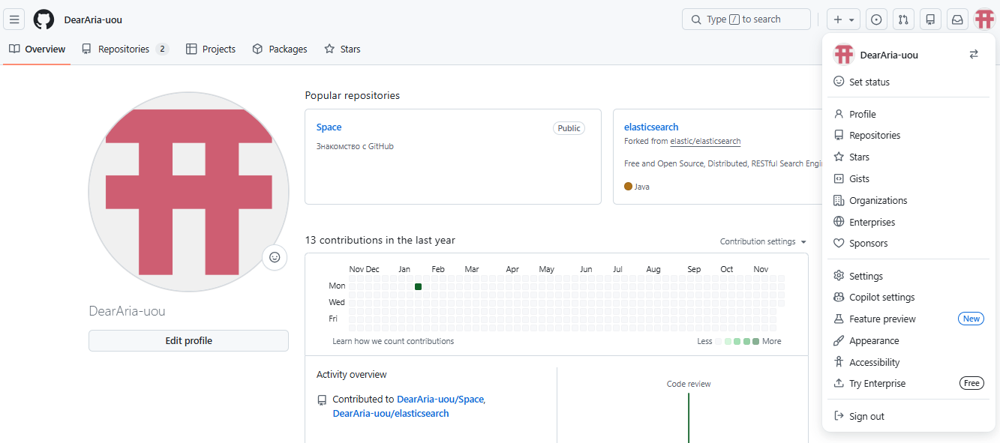  
  *Рис. 1. Аккаунт на GitHub*

- **Пункт 2.** Копирование (форк) внешнего репозитория.  

  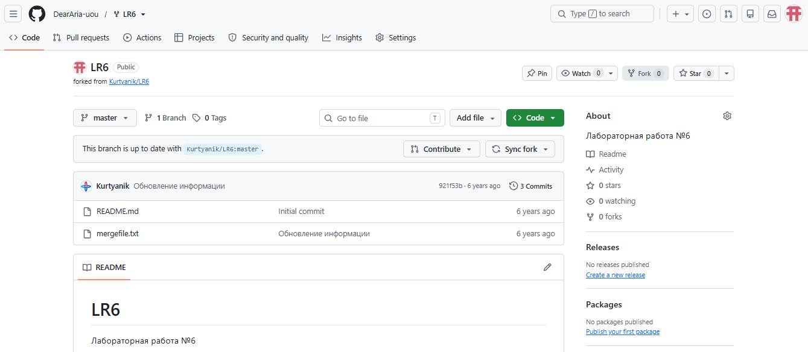  
  *Рис. 2. Форкнутый репозиторий*

- **Пункт 3.** Установка Git.  

  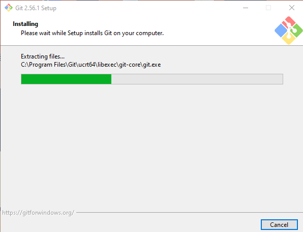  
  *Рис. 3. Окно мастера установки Git*

- **Пункт 4.** Настройка клиента Git (ввод имени и email).  

  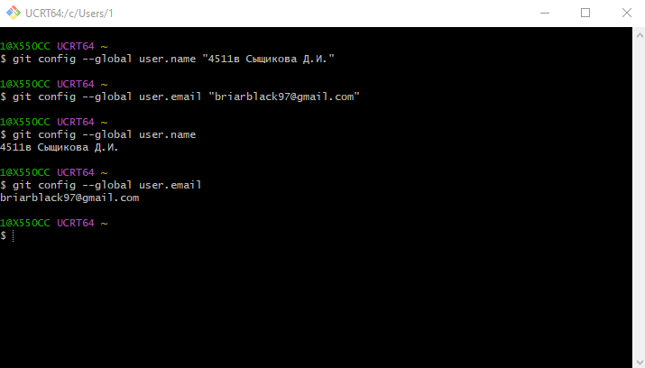  
  *Рис. 4. Ввод имени и email в Git*

- **Пункт 5.** Клонирование личного удалённого репозитория на компьютер.  

  Для дальнейшей работы с локальной копией личного репозитория была создана папка LR6 путём копирования ссылки на сайте GitHub (рис. 5).

  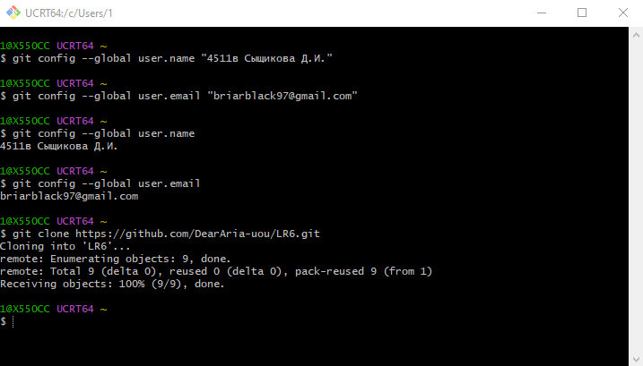  
  *Рис. 5. Результат команды git clone в терминале*

- **Пункт 6.** Добавление файла через интерфейс GitHub. Подтягивание изменений в локальный репозиторий.  

  Для работы с локальным репозиторием при помощи команды cd LR6 был осуществлён вход в папку LR6 (рис. 7).

  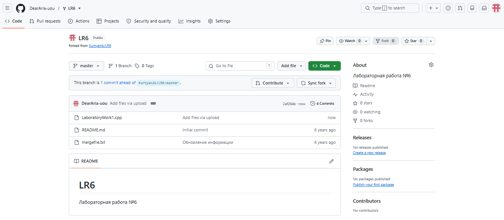  
  *Рис. 6. Интерфейс GitHub после добавления файла*  

  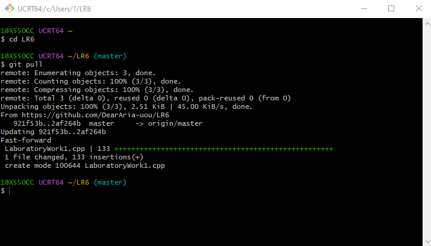  
  *Рис. 7. Отображение изменений в локальном репозитории*

- **Пункт 7.** История операций для каждой ветви.  

  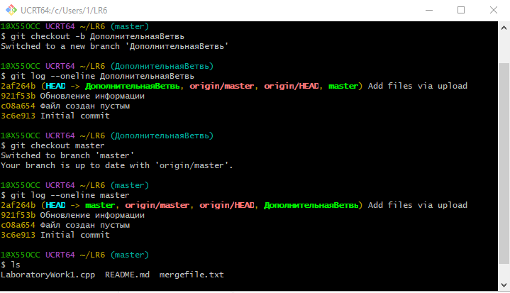  
  *Рис. 8. История операций отдельных ветвей*

- **Пункт 8.** Просмотр последних изменений.  

  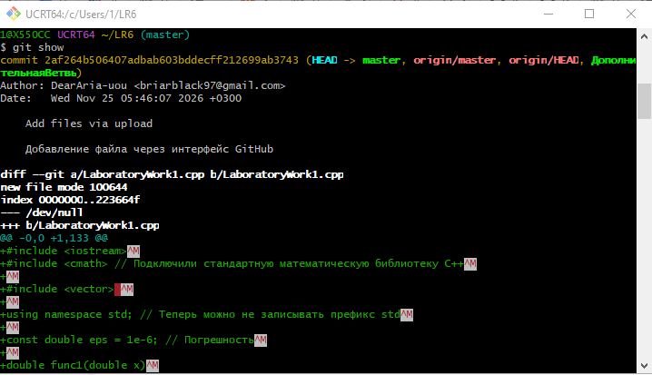  
  *Рис. 9. Данные о последнем коммите*

- **Пункт 9.** Слияние ветвей с разрешением конфликта.  

  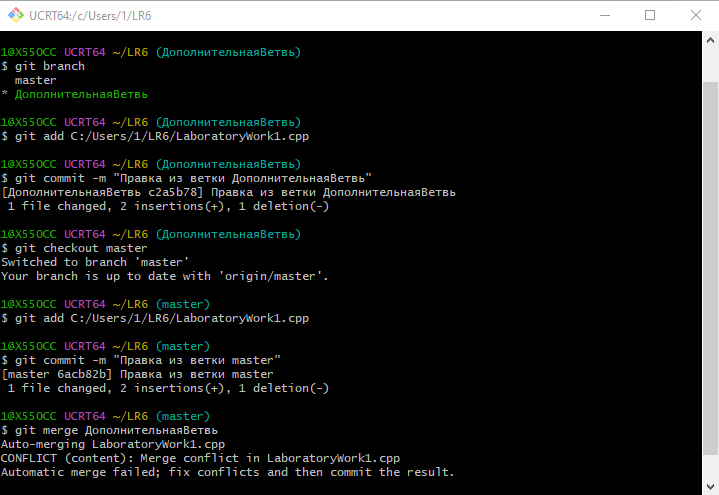  
  *Рис. 10. Обнаружение конфликта при слиянии*  

  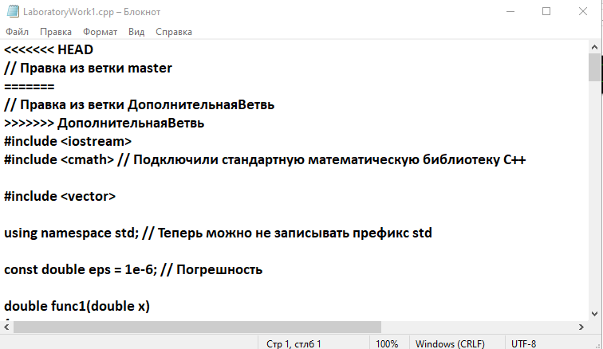  
  *Рис. 11. Ручное исправление конфликта в коде. Часть 1*  

  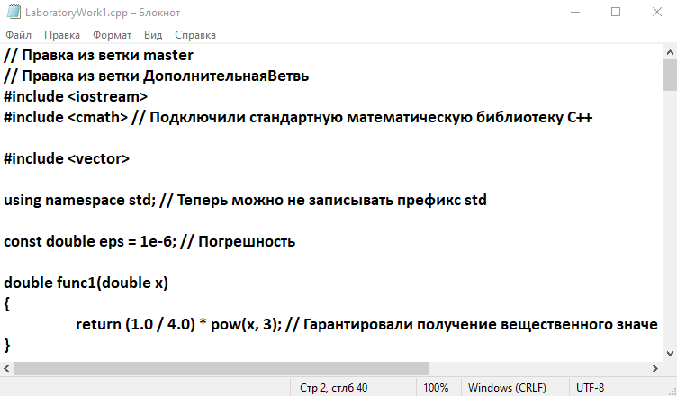  
  *Рис. 12. Ручное исправление конфликта в коде. Часть 2*  

  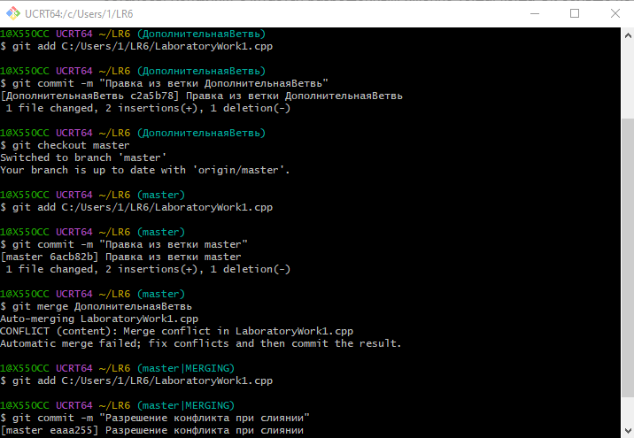  
  *Рис. 13. Разрешение конфликта*

- **Пункт 10.** Удаление побочной ветви.  

  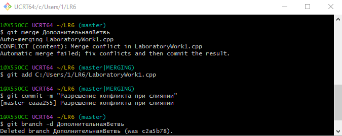  
  *Рис. 14. Удаление ветви ДополнительнаяВетвь*

- **Пункт 11.** Внесение изменений и их фиксация.  

  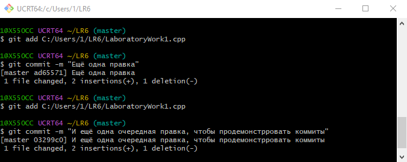  
  *Рис. 15. Изменение файла в редакторе*

- **Пункт 12.** Откат коммита без потери истории.  

  Чтобы релизовать откат коммита безопасным способом, который подразумевает под собой сохранение истории всех коммитов, была применена команда git revert. Результат выполнения данной команды отображён на рис. 16.

  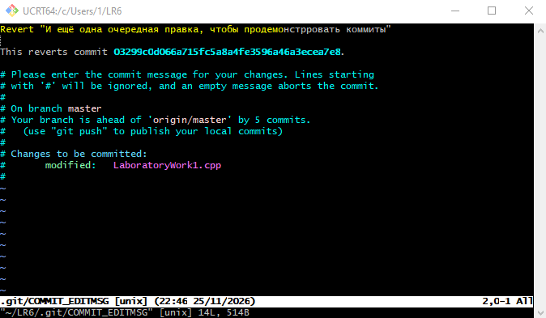  
  *Рис. 16. Использование git revert для отката изменений*

- **Пункт 13.** Создание ветки для отчёта.  

  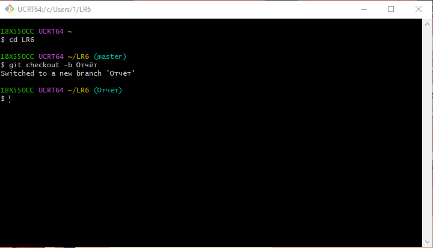  
  *Рис. 17. Создание новой ветки*

- **Пункт 14.** Оформление отчёта в файле README.md и создание коммитов.  

  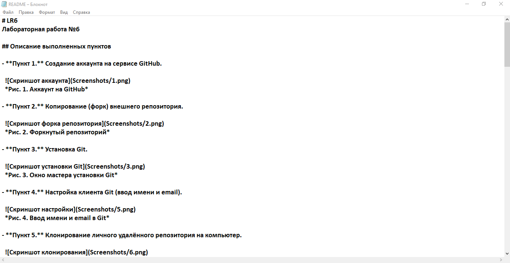  
  *Рис. 18. Редактирование файла README.md*  

  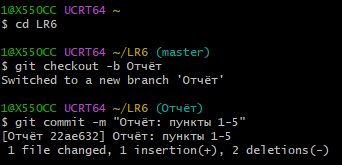  
  *Рис. 19. Осуществление коммита*  

  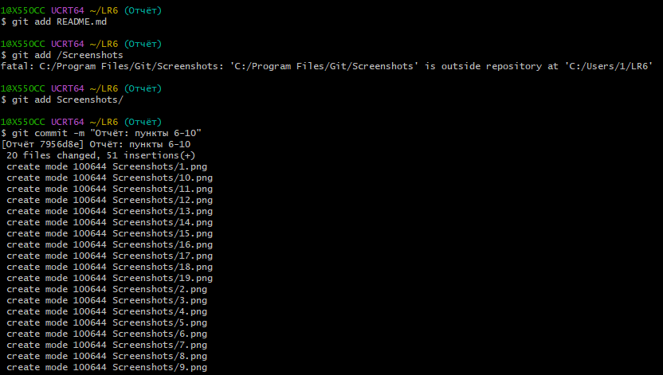  
  *Рис. 20. Осуществление коммита*  

  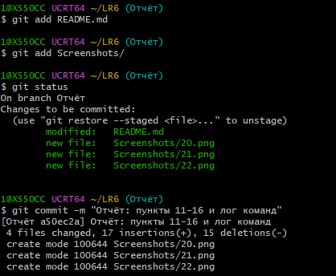  
  *Рис. 21. Осуществление коммита*

- **Пункт 15.** История операций в форматированном виде.  

  История операций, представленная в хронологическом порядке:

	1. **a50ec2a** 2026-11-26 4511в Сыщикова Д.И. Отчёт: пункты 11-16 и лог команд
	2. **7956d8e** 2026-11-25 4511в Сыщикова Д.И. Отчёт: пункты 6-10
	3. **22ae632** 2026-11-25 4511в Сыщикова Д.И. Отчёт: пункты 1-5
	4. **9d5e014** 2026-11-25 4511в Сыщикова Д.И. Правка 2
	5. **1e31a35** 2026-11-25 4511в Сыщикова Д.И. Revert "И ещё одна очередная правка, чтобы продемонстрровать коммиты"
	6. **03299c0** 2026-11-25 4511в Сыщикова Д.И. И ещё одна очередная правка, чтобы продемонстрровать коммиты
	7. **ad65571** 2026-11-25 4511в Сыщикова Д.И. Ещё одна правка
	8. **eaaa255** 2026-11-25 4511в Сыщикова Д.И. Разрешение конфликта при слиянии
	9. **6acb82b** 2026-11-25 4511в Сыщикова Д.И. Правка из ветки master
	10. **c2a5b78** 2026-11-25 4511в Сыщикова Д.И. Правка из ветки ДополнительнаяВетвь
	11. **2af264b** 2026-11-25 DearAria-uou Add files via upload
	12. **921f53b** 2020-11-21 Kurtyanik Обновление информации
	13. **c08a654** 2020-11-21 Kurtyanik Файл создан пустым
	14. **3c6e913** 2020-11-21 Kurtyanik Initial commit

  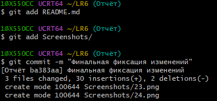  
  *Рис. 22. Финальная фиксация изменений*

- **Пункт 16.** Отправление локальных изменений в сетевое хранилище GitHub.

## Использованные команды

- git config --global user.name "Имя пользователя"
- git clone 
- git add .
- git pull
- git show
- git commit -m "Сообщение"
- git checkout -b <ветка>
- git merge <ветка>
- git revert HEAD
- git log --oneline

## Выводы

  В ходе выполнения задания были освоены: работа с репозиториями на GitHub, базовые команды Git, взаимодействие ветвей: их создание, слияние с разрешением конфликта, а также удаление. Итогом работы стал оформленный в синтаксисе Markdown отчёт со скриншотами и историей коммитов, отправленный в сетевое хранилище GitHub.

